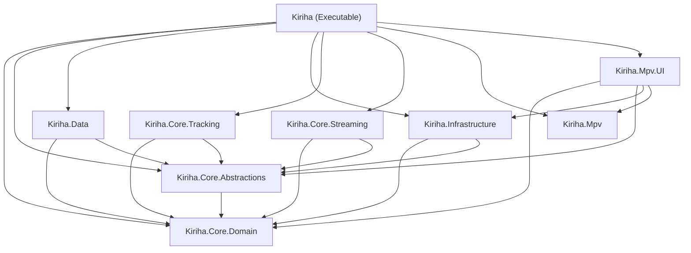

# Kiriha — AI Agent Reference & Architecture Guide

Welcome to the **Kiriha** repository. This document serves as the **single source of truth** for AI assistants and developers. It consolidates the complete architectural map, domain invariants, coding standards, and quality guardrails.

---

## 1. Solution Overview & Project Architecture

Kiriha is a high-performance desktop application built on **Avalonia UI** for tracking, cataloging, scrobbling anime and manga (MyAnimeList, Shikimori, AniList), parsing release schedules, searching releases via Nyaa.si, in-memory BitTorrent streaming via TorrServer, multi-provider online video streaming, and hardware-accelerated playback via embedded `libmpv`.

### 1.1. Project Breakdown & Responsibilities

```
Kiriha.sln
├── src/
│   ├── Kiriha.Core.Domain/        # Pure domain entities, value objects, presentation models, parsers (0 external dependencies)
│   ├── Kiriha.Core.Abstractions/  # Interfaces for repositories, services, UI dispatcher, TorrServer, DI helpers
│   ├── Kiriha.Data/               # EF Core 11 SQLite DbContext, migrations, SQLite repositories, WAL mode connection interceptor
│   ├── Kiriha.Infrastructure/     # TorrServer process management, HTTP cache, Win32 API, Discord RPC, player IPC, external detection
│   ├── Kiriha.Core.Tracking/      # Tracker API clients (MAL, Shikimori, AniList), sync engine, airing schedules, franchise ingestion, Nyaa RSS
│   ├── Kiriha.Core.Streaming/     # Online anime streaming (AniLibria, AnimeLib, DreamCast, YummyAnime, Anime 365, Kodik, Aniboom, Sibnet)
│   ├── Kiriha.Mpv/                # Native libmpv-2.dll P/Invoke interop, OpenGL rendering pipeline, event loop
│   ├── Kiriha.Mpv.UI/             # Player ViewModels, playback state controllers, torrent streaming overlay (ZERO Data/EF Core dependencies)
│   └── Kiriha/                    # Main Avalonia application: XAML Views, ViewModels, DI composition root, navigation
└── tests/
    ├── Kiriha.Tests/              # Comprehensive unit, architectural, regression, and integration tests (xUnit)
    └── Kiriha.Benchmarks/         # Performance benchmarks (BenchmarkDotNet)
```

### 1.2. Architecture Dependency Graph



* **Layer Isolation Invariant:** `Kiriha.Mpv.UI` must **NEVER** reference `Kiriha.Data` or EF Core. Player state and streaming controllers communicate strictly via domain contracts in `Kiriha.Core.Abstractions`.

---

## 2. Tech Stack, Compiler & Quality Guardrails

* **Target Framework:** `.NET 11.0` (C# 15)
* **UI Framework:** `Avalonia UI 12.1.6` with Fluent theme and compiled bindings enabled (`x:DataType` required on all views and templates).
* **Database:** `SQLite` with EF Core 11 (`IDbContextFactory<AppDbContext>`, `NoTracking` by default, WAL mode via custom connection interceptor).
* **Video Player:** Native `libmpv-2.dll` (located in `subprojects/mpv/`), OpenGL rendering integration.
* **Torrent Streaming:** Integrated `TorrServer` (`torrserver.exe`), pure in-memory BitTorrent streaming with direct `libmpv` loopback playback.
* **Central Package Management (CPM):** All NuGet package versions are managed centrally in `Directory.Packages.props`.
* **Compiler & Static Analysis Rules:**
  * `<Nullable>enable</Nullable>` and `<WarningsAsErrors>nullable</WarningsAsErrors>`: **Zero nullable warnings allowed.**
  * `<EnforceCodeStyleInBuild>true</EnforceCodeStyleInBuild>` is active.
  * Roslyn Analyzers active across the entire solution:
    * `SonarAnalyzer.CSharp` (`v10.36.0+`): Detects bugs, resource leaks, complexity smells, and multithreading errors.
    * Do NOT bypass warnings with empty catches, dummy suppressions, or unchecked null-forgiving operators (`!`).
  * Do NOT break existing tests or remove XML comments explaining non-obvious domain/player logic.

---

## 3. Mandatory Core Invariants & Domain Rules

### 3.1. Title Presentation Standard (Strict Invariant)
* **Upper Title:** ALWAYS Japanese title in Romaji (`Presentation.RomajiTitle`).
* **Lower Subtitle:** Russian title (or English if Shikimori/Russian title fetching is disabled or unavailable).
* **Visual Hierarchy:** Romaji title is the primary visual title (`FontWeight="SemiBold"`); Russian/English subtitle is secondary, slightly smaller, and muted (`Opacity="0.7"` or `{DynamicResource TextMuted}`).
* Never swap or replace the Romaji title with English titles on cards, details, or header banners.

### 3.2. Two Application Execution Modes
1. **Main Desktop Tracker:** Runs full Avalonia UI, background sync supervisors, tracker integration, and database operations.
2. **Lightweight Player Mode (`--player <file>`):** Spawns a dedicated standalone player window without database initialization or sync overhead.

### 3.3. Torrent Streaming Architecture (TorrServer)
* Managed via `ITorrServerService` (`src/Kiriha.Infrastructure/TorrServer/`).
* Runs as a managed child process or connects to an existing instance. Configured for pure RAM streaming cache (0 disk bytes).
* Direct streaming to `libmpv` via loopback HTTP (`http://127.0.0.1:<port>/stream/...`).
* Real-time OSD overlay tracks buffer, peer count, and download speed in `PlayerViewModel.TorrentStreaming.cs`.
* Graceful termination handled via `TorrServerShutdownHandler`.

### 3.4. Multi-Provider Online Streaming & Scoring
* Multi-provider search and stream extraction reside in `src/Kiriha.Core.Streaming/`.
* Dual Torrents/Online search toggle is persisted via `AppSettings.TorrentConfig.IsOnlineMode` across restarts.
* Relevance scoring (`OnlineRelevanceScorer`) ranks exact and close title matches above fuzzy/junk results.
* Provider badges in search results strictly adhere to `GroupChip` styling (clean typography, no icons, 5px radius, 6,2 padding, themed `AnalyticsSection*Brush`). Default online source is AniLibria only (`1/5`).

### 3.5. Database & Concurrency Invariants
* Always use `IDbContextFactory<AppDbContext>` to create short-lived contexts.
* SQLite WAL mode is configured globally via `SqliteConnectionInterceptor`.
* Always use asynchronous database operations: `await connection.BeginTransactionAsync(ct)`, `await command.ExecuteNonQueryAsync(ct)`, and `await transaction.CommitAsync(ct)`. Never block thread pool threads with synchronous database calls.

### 3.6. Dependency Injection & Service Registration
* Registrations reside in `src/Kiriha/Composition/*Registration.cs` (or project-level `*Registration.cs`).
* When registering a class under multiple interfaces, use `AddForwardedSingleton<TImpl, TIface>()` or `sp.GetRequiredService<TImpl>()` to avoid duplicate singleton instances.

---

## 4. Engineering Standards & AI Ergonomics (Goldilocks Zone 150 – 400 Lines)

### 4.1. The Goldilocks Zone (150 – 400 Lines per File)
- ⚠️ **MANDATORY FOR ALL CODE GENERATION, REFACTORING & ARCHITECTURAL DESIGN:**
  - Every class, helper, parser, and ViewModel must ideally target **150 to 400 lines of code**.
  - **Key Invariants & AI Benefits:**
    1. **1 File = 1 Domain Responsibility (SRP):** Each file focuses on a single distinct concern (e.g. tokenization, regex matching, provider stream extraction, scoring, layout calculation).
    2. **Single-Call Full Read (`read_file`):** The entire file fits completely within a single read call without truncation, chunking, or pagination. Context is 100% visible, eliminating context drift and hallucinations.
    3. **Exhaustive Scope Context:** All private helpers, invariants, and local state needed by a method are visible together in the same compact scope.
    4. **Surgical Diff Modification:** Allows precise, error-free diffs (`edit_file`) without risk of search-target ambiguity or accidental collateral damage across large unrelated blocks.
    5. **Zero Micro-Splitting (Avoid Anti-Pattern):** Do **NOT** splinter cohesive logic into dozens of trivial 10-line files. Group related domain logic together so the class remains meaningful and self-contained within the 150–400 line band.
- **Strict Superfile Prohibition (God Objects > 600 lines, strictly forbidden > 1,000 lines):**
  - Monolithic helpers (e.g. `AnimeReleaseParser`, `AnimeLibraryMatcher`, `FranchiseLayoutEngine`) must be decomposed into domain modules (`Tokens/`, `Scoring/`, `Matching/`, `Layout/`). The original class remains a lightweight facade (<100 lines) preserving all public signatures for 100% backward compatibility.
  - Large ViewModels must be partitioned into SRP partial classes by functional domain (`<Name>ViewModel.<Domain>.cs`, e.g. `.Online.cs`, `.Filters.cs`, `.Search.cs`, `.Auth.cs`).

### 4.2. Modern C# 15 & .NET 11 Idioms
- **Collection Expressions:** Use `[...]` instead of `new List<T>()`, `new[] { ... }`, or `Array.Empty<T>()`.
- **Frozen Collections:** Always use `FrozenSet<T>` and `FrozenDictionary<K, V>` for static/immutable lookup tables (e.g. genres, Chinese/Korean studio classifications, tag prefixes) to ensure zero-allocation reads.
- **Primary Constructors:** Use primary constructors for dependency injection across services, controllers, and repositories where clean.
- **Pattern Matching & Switch Expressions:** Prefer switch expressions and pattern matching over deep `if / else` chains.
- **Null Safety:** Strictly honor nullable reference types. Always handle nullable returns with explicit fallbacks or guards rather than using `!`.

---

## 5. UI/UX & Avalonia Standards

1. **Compiled Bindings:** Always specify `x:DataType` on root views, styles, and DataTemplates.
2. **TitleBar Drag vs. PointerPressed:**
   - **NEVER** put `PointerPressed="OnTitleBarPressed"` on the root `<Grid>` or root `<Window>`. It intercepts pointer events from children and breaks `ComboBox`, `ColorPicker`, and popup dropdowns.
   - `PointerPressed="OnTitleBarPressed"` must ONLY be declared on the dedicated top titlebar element.
3. **DataGrid & CheckBox Alignment Standards:**
   - Never add horizontal margins inside `DataGridTemplateColumn.CellTemplate` (causes double indentation).
   - Centered discrete metadata columns (status, type, size, episode numbers).
   - Text columns left-aligned with `TextTrimming="CharacterEllipsis"`.
   - Star-sizing on expandable text columns to eliminate trailing blank gray space.
4. **ListBox & ScrollViewer Gutters:**
   - Always provide an explicit right margin (12–14px) on the rightmost element in item templates to prevent overlay scrollbars from covering text.
5. **Virtualization (`ItemsRepeater`):**
   - High-volume lists (Torrents, Episodes, Anime Library, Seasonal grids) must use `ItemsRepeater` inside `ScrollViewer` with virtualizing stack or uniform grid layouts.

---

## 6. Verification Commands

* **Compile Solution (Debug):**
  ```powershell
  dotnet build Kiriha.sln -c Debug
  ```
* **Compile Solution (Release):**
  ```powershell
  dotnet build Kiriha.sln -c Release
  ```
* **Run Unit Tests:**
  ```powershell
  dotnet test Tests/Kiriha.Tests/Kiriha.Tests.csproj -c Debug
  ```
* **Run Benchmarks:**
  ```powershell
  dotnet run --project tests/Kiriha.Benchmarks -c Release
  ```
