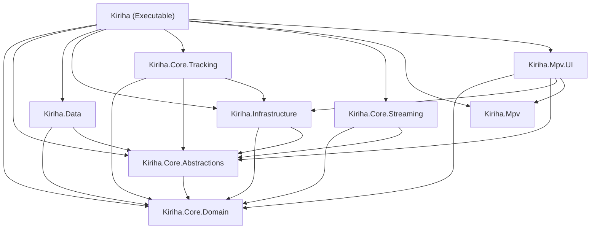

# Kiriha — Карта архитектуры и устройства проекта

> **Версия:** 1.7.2+  
> **Стек:** .NET 11.0 RC2 (C# 15), Avalonia UI 12.1.4, Entity Framework Core 11 RC2 (SQLite), libmpv, TorrServer  
> **Платформа:** Windows (x64)

Документ представляет собой системную карту архитектуры приложения Kiriha для разработчиков и ИИ-ассистентов, а также сводку архитектурных инвариантов ядра.

---

## 1. Обзор решения (Solution Overview)

Kiriha — настольное приложение на Avalonia UI для каталогизации, трекинга и автоматического скробблинга аниме и манги/ранобэ (MyAnimeList, Shikimori, AniList), парсинга расписаний выхода серий, поиска релизов через Nyaa.si, потокового воспроизведения торрентов через TorrServer, мульти-провайдерного онлайн-стриминга и воспроизведения видео через встроенный `libmpv`.

### Структура проектов (.csproj)

```
Kiriha.sln
│
├── src/
│   ├── Kiriha.Core.Domain/           # Чистые доменные сущности, модели, парсеры релизов/названий (0 внешних зависимостей)
│   ├── Kiriha.Core.Abstractions/     # Контракты репозиториев, сервисов, диспетчера UI и жизненного цикла
│   ├── Kiriha.Data/                  # EF Core SQLite, миграции, репозитории и обслуживание БД (зависит только от Domain + Abstractions)
│   ├── Kiriha.Infrastructure/        # TorrServer, условный HTTP-кеш, Win32 API, Discord RPC, IPC плеера, ExternalDetection
│   ├── Kiriha.Core.Tracking/         # API-клиенты (MAL, Shiki, AniList), синхронизация списков, история, аир-инфо, франшизы, Nyaa RSS
│   ├── Kiriha.Core.Streaming/        # Онлайн-стриминг (AniLibria, AnimeLib, DreamCast, YummyAnime, Anime 365, Kodik, Aniboom, Sibnet)
│   ├── Kiriha.Mpv/                   # C# P/Invoke обертка над native libmpv-2.dll, цикл событий, рендерер OpenGL
│   ├── Kiriha.Mpv.UI/                # ViewModels и контроллеры плеера, оверлей торрент-стриминга (без ссылок на EF Core / Data)
│   └── Kiriha/                       # Главное приложение: Avalonia XAML Views, ViewModels, DI Composition, навигация
│
└── tests/
    ├── Kiriha.Tests/                 # Юнит-, архитектурные и интеграционные тесты (xUnit)
    └── Kiriha.Benchmarks/            # Бенчмарки производительности (BenchmarkDotNet)
```

---

## 2. Граф зависимостей проектов (Dependency Graph)



---

## 3. Назначение и ответственность проектов

### 3.1. `Kiriha.Core.Domain`
* **Роль:** Самый глубокий слой ядра. Не имеет внешних NuGet- или проектных зависимостей.
* **Ключевые типы:**
  - `AnimeEntity` (частичный класс): главная доменная модель тайтла (аниме, манга, ранобэ по составному ключу `(Id, MediaKind)`).
  - `AnimeEntityPresentation`: проекция данных для биндингов Avalonia UI (бейджи выхода серий, прогресс, связи франшизы, переключение русских/оригинальных названий и описаний).
  - `AppSettings`: типизированная конфигурация (`UI`, `System`, `Player`, `Torrents`, `Api`).
  - `HistoryItem`, `HistoryActionType`, `HistoryContext`: запись истории действий с `MediaKind` и JSON-состоянием синка по трекерам.
  - `Utils/Parsing/`: чистые детерминированные парсеры и матчеры без I/O (`AnimeReleaseParser`, `AnimeParseCache`, `AnimeStringHelper`, `AnimeLibraryMatcher`, `LruStringMemoizer`).
  - `CollectionReconciliation`, `FormatCatalog`, `GenreCatalog`, `AnimeSearchQueryParser`.

### 3.2. `Kiriha.Core.Abstractions`
* **Роль:** Узкие интерфейсы и контракты между слоями.
* **Группы контрактов:**
  - `Repositories/`: `IUserAnimeRepository`, `IMetadataRepository`, `IAnimeRepository` (включая потокобезопасный O(1) `FindById`), `IHistoryRepository`, `ISyncTaskRepository`, `IMalSearchCacheRepository`, `IAnimeRelationRepository`, `IHttpCacheRepository`, `ITorrentFilterRepository`, `ISeasonalHiddenRepository`, `IAnimeCountryRepository`.
  - `Services/`: `IMalApiService`, `IShikiApiService`, `IAniListApiService` (`: ITrackerService`), `ITrackerService`, `ISyncManager`, `IAnimeSyncOrchestrator`, `IAiringInfoService`, `IFranchiseService`, `IHistoryService`, `ISettingsService`, `IDatabaseInitializer`, `IRecognitionCache`, `IMappingService`, `INotificationService`, `IDiscordService`, `ILocalizer`, `ITorrServerService`, `IInternalPlayerServer`.
  - `Infrastructure/`: `IUiDispatcher` (включая `CheckAccess()`), `IBackgroundTaskSupervisor`.

### 3.3. `Kiriha.Data`
* **Роль:** Изолированное хранилище данных на SQLite + EF Core (не зависит от `Kiriha.Infrastructure`).
* **Ключевые компоненты:**
  - `AppDbContext`: контекст БД с `QueryTrackingBehavior.NoTracking` и WAL-режимом через `SqlitePragmaConnectionInterceptor`.
  - `DatabaseInitializer`, `DatabaseMaintenance`, `CacheCleanupService`, `LegacyUserStateMigration` (однократная миграция с архивацией `.migrated`).
  - `Repository/`: реализации репозиториев (`UserAnimeRepository`, `MetadataRepository`, `HistoryRepository` с сериализацией RMW-обновлений `tracker_status_json`, `SyncTaskRepository` и др.).

### 3.4. `Kiriha.Infrastructure`
* **Роль:** Интеграция с ОС, процессами, файловой системой и сетевым кешированием.
* **Ключевые компоненты:**
  - `TorrServer/`: `TorrServerService` — запуск/подключение к `torrserver.exe`, RAM-кеш (0 байт на диске), опрос прогресса и авто-дроп.
  - `Tracking/ExternalDetection/` и `Tracking/Integration/`: обнаружение внешних плееров (MPC-HC, mpv, VLC, PotPlayer) через Win32 хэндлы окон и WASAPI, `DiscordService`, дуплексный пайп-сервер `InternalPlayerServer`.
  - `Utils/Parsing/EmberTitleResolver.cs`: резолвинг названий релизов `[Ember]` по метаданным родительской директории с мемоизацией заголовка MKV.
  - `Http/HttpConditionalCache.cs`: поддержка условных HTTP GET (`ETag` / `304 Not Modified`).
  - `Platform/`: `PathHelper`, `ShellLauncher`, `WindowsStartupManager`.

### 3.5. `Kiriha.Core.Tracking`
* **Роль:** Интеграция с внешними аниме-трекерами, синхронизация, история, метаданные, граф франшиз и распознавание тайтлов.
* **Ключевые компоненты:**
  - `Services/Api/`: `MalApiService`, `ShikiApiService` (с общим `ShikiStateCache` и `ShikiGraphQlPosterFetcher`), `AniListApiService` (с персистентным кешем нативных AniList ID без MAL ID).
  - `Services/Sync/`: `SyncManager`, `AnimeSyncOrchestrator` + `LibrarySyncGate`, `AnimeListActionService`, `AnimeProgressService`.
  - `Services/Tracking/Core/`: `TrackingService`, `ScrobbleService`, `HistoryService`, `AiringInfoService`.
  - `Services/Mapping/`, `Services/Franchise/`, `Services/Metadata/`: `MappingService`, `RecognitionCache`, `ManualMappingService`, `FranchiseService`, `ShikiMetadataService`.
  - `Services/Feed/`: `RssFeedService`, `NyaaFeedClient`, `NyaaTorrentParser`.

### 3.6. `Kiriha.Core.Streaming`
* **Роль:** Каталоги онлайн-просмотра аниме, ранжирование выдачи и извлечение видеопотоков (HLS, MP4, DASH).
* **Ключевые компоненты:**
  - `Providers/`: `AniLibriaProvider`, `AnimeLibProvider`, `DreamCastProvider`, `YummyAnimeProvider`, `Anime365Provider`.
  - `Extractors/`: `KodikVideoExtractor`, `AniboomVideoExtractor`, `SibnetVideoExtractor`, `Anime365Extractor`.
  - `Services/` и `Helpers/`: `StreamingService`, `OnlineRelevanceScorer`, `UrlRedactor` (редакция токенов в логах).

### 3.7. `Kiriha.Mpv` и `Kiriha.Mpv.UI`
* **Роль:** Видеоплеер.
* `Kiriha.Mpv`: низкоуровневая обертка P/Invoke `libmpv-2.dll`, OpenGL контекст, событийный цикл плеера.
* `Kiriha.Mpv.UI`: `PlayerViewModel`, контроллеры воспроизведения, субтитров и хоткеев, оверлей торрент-стриминга (`PlayerViewModel.TorrentStreaming.cs`). Не имеет зависимостей от `Kiriha.Data` или EF Core.

### 3.8. `Kiriha` (Основное приложение)
* **Роль:** UI на Avalonia UI, композиция DI, точка входа (`Program.cs`, `App.axaml.cs`).
* **Ключевые компоненты:**
  - `Composition/`: модульная регистрация DI (`DataServicesRegistration`, `TrackingServicesRegistration`, `BackgroundServicesRegistration`, `UiServicesRegistration`).
  - `Services/AppLifecycle/Shutdown/`: упорядоченный пайплайн завершения работы:
    1. `TorrServerShutdownHandler`
    2. `PlayerResidentShutdownHandler`
    3. `HostedServicesShutdownHandler` (остановка в обратном порядке запуска до отмены `BackgroundTaskSupervisor`)
    4. `BackgroundTasksShutdownHandler`
    5. `ManualMappingShutdownHandler`
    6. `SettingsShutdownHandler`
    7. `HistoryShutdownHandler`
    8. `DatabaseShutdownHandler` (`WAL checkpoint(TRUNCATE)`)

---

## 4. Паттерны и архитектурные конвенции

1. **Регистрация сервисов в DI:** `AddForwardedSingleton<TImpl, TIface>()` исключает создание дублирующихся синглтонов.
2. **Строгая типизация и Null-Safety:** `<WarningsAsErrors>nullable</WarningsAsErrors>` включён во всём решении.
3. **Потокобезопасность библиотеки:** Вне UI-потока поиск по библиотеке выполняется через потокобезопасный индекс `IAnimeRepository.FindById(id, kind)` или `GetSnapshotAsync()`, без прямого перебора `ObservableCollection`.
4. **Статический контроль качества (`HardcodeAnalysisTests`):** Автоматически запрещены захардкоженные URL вне `Constants/`, дублирующиеся нетривиальные строковые литералы между файлами, неименованные магические таймауты и кириллица в C#-коде вне констант.

---

## 5. Реестр закрытого технического долга и легаси

* **Удалены мёртвые подсистемы и таблицы:** `SmtcService`, `AnimeGoProvider`, пакет `AngleSharp`, таблицы `episode_releases`, `episode_list_meta`, `file_recognition_cache` (миграция `CoreSchemaCleanup`), дубликаты `SmoothScroll` в `Kiriha.Mpv.UI`, зомби-поля `HiddenSeasonalIds`/`HiddenAnimeIds`/`PerTitleFilters` в `AppSettings`.
* **Выровнены границы слоёв:** `Kiriha.Data` полностью отвязан от `Kiriha.Infrastructure`; чистые парсеры перенесены в `Kiriha.Core.Domain`; `HistoryService` вынесен в `Kiriha.Core.Tracking`.
* **Устранены скрытые рантайм-дефекты:** исправлено форматирование скорости/объёма торрентов (`:0.#` / `:0.##`), сохранение `ShikiMetadata.PosterUrl` в SQLite и защита метаданных `Manga`/`LightNovel` с битовыми масками от авто-очистки, сериализация обновлений `tracker_status_json` в `HistoryRepository`, отображение `LightNovel` во вкладке манги, проброс `MediaKind` в историю и синхронизацию, устранено удержание `LibrarySyncGate` во время HTTP-запросов `AiringInfoService`.

---

## 6. Архитектурные инварианты (проверяются автотестами)

* `Kiriha.Core.Domain` не имеет внешних зависимостей.
* `Kiriha.Data` не ссылается на `Kiriha.Infrastructure`, `Kiriha.Core.Tracking` или UI-проекты.
* `Kiriha.Mpv.UI` не ссылается на `Kiriha.Data` или `Microsoft.EntityFrameworkCore`.
* Любые изменения в `/src` обязаны проходить статический анализатор `HardcodeAnalysisTests` с нулём предупреждений компилятора.
